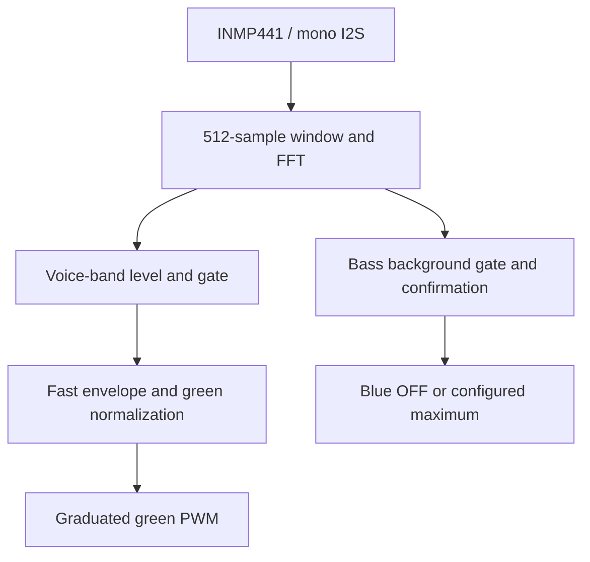

# SonicSync32

**ESP32-C6 audio-reactive LED controller** — listens to music through an
INMP441 I2S microphone and drives two LED channels with real-time FFT
frequency analysis.

| LED channel | Reacts to                     |
|-------------|-------------------------------|
| **Green**   | Fast, graduated response to voice-range energy (300–3400 Hz) |
| **Blue**    | Binary bass indicator (40–250 Hz): OFF or configured maximum |

This is frequency-reactive lighting, not speech recognition. Green follows
speech-band level and articulation; other sounds in that band can trigger it.
Blue switches on when bass passes its background-aware gate and switches off
when the gate closes. Sustained bass holds blue on; it is not a timed strobe.

## Key features

- **ESP-IDF 6.0.1 on ESP32-C6** — RISC-V, 160 MHz single core; built with
  PlatformIO.
- **I2S master capture** — the mic's 24-bit Philips payload is received in
  32-bit words/slots (64 BCLK per frame), mono left, DMA-driven at 16 kHz.
- **Self-contained FFT DSP** — in-place radix-2 Cooley–Tukey FFT with Hann
  windowing in plain C; zero external DSP libraries.
- **Noise gate with hysteresis** — silence keeps both LEDs fully dark, and
  hysteresis stops flicker at the threshold.
- **Independent channel response** — blue uses a higher, background-aware
  gate and a short trigger confirmation, then switches directly to the
  configured brightness cap. Green keeps its voice threshold with a sharper
  syllable response.
- **Green loud-music normalization** — adapts green's upper reference during
  loud voice-band passages. Blue stays binary and loud bass cannot dim green
  through the normalizer. Quiet input is never amplified.
- **Fast green speech envelope** — 15 ms attack / 90 ms release time constants
  follow articulation. A qualifying new syllable responds on the first FFT
  block rather than rising from the silent -120 dBFS floor.
- **Green gamma-corrected brightness mapping** with sensitivity control;
  both channels respect the configured maximum brightness.
- **Failsafe startup** — LED outputs forced off at reset; the one-time
  readiness animation runs only after successful initialization, so a failed
  init never produces a successful-ready indication.
- **Everything tunable via `menuconfig`** — pins, bands, gate, span,
  sensitivity, gamma, smoothing and brightness limits.

## How it works

### Audio pipeline



**Capture.** The ESP32-C6 acts as I2S master and clocks the microphone
directly: 32-bit RX words in 32-bit slots yield 64 BCLK ticks per
frame. `MONO` + `LEFT` keeps the mic's left channel (L/R tied to GND).
The signed 24-bit payload occupies bits 31:8; the low eight bits are discarded.
On ESP32-C6, 24-bit RX uses packed 3-byte samples and stereo RX includes both
slots regardless of the mask, so neither matches an array of mono `int32_t`
samples. Sampling at 16 kHz gives
a 0–8 kHz analysis range, comfortably covering both bands at a fraction of the
CPU and DMA load of 44.1 kHz. A DMA ring buffer decouples the peripheral from
processing.

**Frequency analysis.** Every 512 samples (32 ms, ≈ 31 frames/s) the firmware
removes the DC component, applies a Hann window to limit spectral leakage,
and runs an in-place radix-2 Cooley–Tukey FFT — roughly 5k butterfly
operations per frame, negligible for the C6. The bin width is 31.25 Hz, so
the default bands map to FFT bins 1–8 (bass, 40–250 Hz) and 10–109 (voice,
300–3400 Hz).

**Levels and gating.** Signed PCM is divided by 8388608 before the FFT,
giving samples in [-1, 1). One-sided band energy is converted to RMS power
using `2 * energy / (FFT_size * sum(Hann_window_squared))`, then to dBFS.
A full-scale sine is approximately -3.01 dBFS RMS. Green keeps its original
-50 dBFS closing gate and -47 dBFS opening threshold. Blue's minimum gate
is -40 dBFS, with 5 dB opening hysteresis and 64 ms of consecutive above-gate
input before it activates. A closed gate immediately forces its PWM duty to
zero, overriding any residual smoothed envelope.

**Bass background rejection.** After the readiness animation, blue stays
off for 1.5 seconds while a bounded histogram measures the 80th percentile
of the room's bass level. Keep music off for this short interval. Green is
active throughout. Blue then uses the higher of its minimum gate and the
learned background plus 8 dB. The initial calibrated gate is now retained as
a lower bound for the current calibration. Quiet gaps can lower the running
noise estimate, but cannot lower this minimum gate and make blue more
sensitive again. The estimate rises slowly only while the bass gate is
closed and freezes during candidate or detected bass. A single 32 ms spike
does not activate blue.

This rejects steady background and brief spikes; it cannot identify every
noise source. Real disturbances that are stronger and longer than the
threshold can still look like bass. If music was already playing during
calibration, reboot with music off to obtain a new quiet calibration. The
stable minimum deliberately replaces automatic downward gate drift.

**Green speech response and mapping.** The gated voice level feeds a 15 ms
attack / 90 ms release exponential envelope. A newly opened voice gate seeds
the envelope at the gate level, so short syllables are visible immediately.
The output still updates once per FFT block (32 ms at the default settings);
15 ms is an envelope time constant, not a faster capture/update interval.
The smoothed level maps to a
12-bit LEDC duty cycle through `(level - channel_gate) / (reference - channel_gate)`
(minimum span 6 dB), multiplied by master sensitivity and clamped to [0, 1].
The curve exponent is `gamma_percent / green_response_percent`: green
response 85 gives about 2.12. Lower response makes intermediate levels darker while retaining the
configured full-brightness endpoint. The existing master sensitivity remains
available as a separate multiplier. A closed voice gate forces green to zero
on the next processed block, preserving clear gaps between words.

**Binary bass output.** Once bass qualifies, blue duty is exactly
`SONICSYNC_MAX_BRIGHTNESS` (4095 by default). When its gate is closed, duty
is exactly zero. There is no intermediate brightness, envelope fade, gamma
or volume normalization on blue. Background calibration, hysteresis and
64 ms confirmation remain in place to limit unwanted flicker.

**Green loud-music normalization.** The normal upper reference is -12 dBFS (base
gate -50 plus span 38). Only active, noise-gated voice-band input can raise it,
toward its level plus 3 dB headroom, capped at 0 dBFS. It rises over a 150 ms
time constant and recovers over 4 seconds. It never drops below the normal
reference, so it cannot boost quiet input or turn a rejected background into
music. This changes the LED display range only; microphone/ADC clipping
cannot be repaired by a brightness algorithm.

## Behavior

### Boot readiness animation (once per boot)

On every cold power-on or restart:

1. Both LED outputs initialize **OFF** (pins driven low before PWM setup).
2. LED controls and I2S microphone capture initialize.
3. Only after successful initialization, the readiness animation runs:
   - Green blinks 3× (blue stays off), then blue blinks 3× (green stays off).
   - The pattern repeats for **3 rounds**.
   - Timing: 150 ms ON / 150 ms OFF at reduced brightness (25 % of full
     scale by default). Only one channel is lit at a time.
4. Both LEDs turn OFF; audio capture is already running; the firmware waits
   for music and switches to audio-reactive lighting automatically when music
   is detected.
5. For the first 1.5 seconds after the animation, keep music off while blue
   learns the background. Green is active during this interval. The console
   announces when bass background calibration finishes. The animation does
   not replay.

The animation runs **exactly once per boot** — it is never looped while
waiting and never replayed when music starts or stops. If initialization
fails, both LEDs stay OFF permanently and the failure is logged to the serial
console.

### Normal operation

- Every 32 ms the FFT block is processed and the green/blue LED duties are
  updated (~31 updates/s).
- **Silence keeps both LEDs off.** Noise-gated levels below the threshold
  always force duty 0, including on the first quiet block after music.
- Capture errors or timeouts clear both outputs and reset the gate/envelope
  states, normalization reference and bass background learning. The readiness
  animation does not replay. Reads have a finite timeout based on block duration.
- Green follows speech-band levels with its fast envelope and graduated
  brightness. Blue is OFF or the configured cap according to bass presence;
  sustained above-gate bass holds it ON.

## Hardware

### Wiring (ESP32-C6)

| Connection                | ESP32-C6 pin |
|---------------------------|--------------|
| INMP441 VDD/VCC           | 3V3          |
| INMP441 GND               | GND          |
| INMP441 SCK (BCLK)        | GPIO6        |
| INMP441 WS (LRCLK)        | GPIO7        |
| INMP441 SD (data → ESP32) | GPIO10       |
| INMP441 L/R               | GND (left channel) |
| Green LED driver control  | GPIO18       |
| Blue LED driver control   | GPIO19       |

All pins are configurable via `menuconfig`; the table lists the defaults.

### Power and LED driver requirements

- The **LED circuit is supplied from 12 V**; a buck converter supplies **5 V**
  to the ESP32 (e.g., to the 5V pin of the dev board).
- **All grounds are common** (12 V supply, LED drivers, ESP32, INMP441).
- The GPIO18/GPIO19 outputs go to the **LED driver inputs only** — they must
  not sink/source LED current directly.
- **Verify the installed LED driver board and its current limiting before
  full-power testing of the 20 W LEDs.** Start at reduced brightness
  (`SONICSYNC_MAX_BRIGHTNESS`) and check driver/heatsink temperatures.
- The INMP441 runs from 3V3. Its L/R pin goes to GND to select the left
  channel (matching the firmware's left-slot capture).

## Configuration

All tuning values live in `src/Kconfig.projbuild` and are edited at build
time with:

```
pio run -t menuconfig
```

under **SonicSync32 Configuration**. Defaults:

| Option                        | Default | Meaning |
|-------------------------------|---------|---------|
| Sample rate                   | 16000 Hz| I2S capture rate |
| I2S BCLK / WS / SD GPIOs      | 6 / 7 / 10 | Microphone pins |
| Green / Blue GPIOs            | 18 / 19 | LED driver pins |
| Bass band                     | 40–250 Hz | Blue channel band |
| Voice band                    | 300–3400 Hz | Green channel band |
| FFT size                      | 512     | Block length (power of two) |
| Base/green gate               | −50 dBFS RMS | Green closing threshold |
| Green gate hysteresis         | 3 dB    | Green opening threshold is -47 dBFS |
| Bass gate offset              | +10 dB  | Minimum blue closing gate is -40 dBFS |
| Bass gate hysteresis          | 5 dB    | Quiet-baseline opening threshold is -35 dBFS |
| Bass trigger confirmation     | 64 ms   | Reject isolated one-frame spikes |
| Bass startup calibration      | 1500 ms | Keep music off briefly after the animation |
| Bass background margin        | 8 dB    | Minimum difference above learned background |
| Blue output                   | 0 / configured cap | Binary, no brightness graduation |
| Green response                | 85 % | Darker intermediate levels, full endpoint retained |
| Base span                     | 38 dB   | Normal upper reference = base gate + span |
| Green master sensitivity      | 100 %   | Green brightness multiplier; blue bypasses it |
| Normalization headroom        | 3 dB    | Above the loudest active band |
| Normalization attack/release   | 150 / 4000 ms | Smooth loud-section adjustment/recovery |
| Gamma                         | 180 %   | Perceptual curve exponent |
| Green attack / release        | 15 / 90 ms | Faster speech articulation |
| Max brightness                | 4095    | 12-bit PWM full scale |
| Animation brightness          | 1023    | Readiness blink level |
| LED PWM frequency             | 1000 Hz | Driver PWM |

Persistent overrides can also go in `sdkconfig.defaults.esp32c6`.

### Tuning tips

- At the default Info log level, the console prints bass/voice levels in
  dBFS, bass background/gate, normalization reference, calibration progress
  and green/blue PWM duties about once per second.
- For residual blue flicker, inspect its learned floor and gate. Adjust the
  **bass** margin, offset or confirmation time independently; do not raise
  the base gate just to fix blue, since it would also suppress green.
- For darker/brighter green intermediate levels, change the green response
  percentage. Blue always uses the configured maximum as its ON state.
  Detection thresholds and green brightness response are separate controls.
- Green's new attack/release options supersede the old general envelope
  settings. Old saved values remain accepted but are hidden and inactive;
  new speech timing defaults apply without deleting the generated sdkconfig.
- On an existing checkout, new Kconfig options acquire their defaults during
  configuration. Preserve existing board/pin settings; there is no need to
  delete the entire generated sdkconfig. The serial startup summary confirms
  the values actually compiled into a build.
- If bass reaction is weak, verify the audio actually contains bass; the
  band edges are configurable.

## Getting started

### Prerequisites

- **PlatformIO** — either the CLI (`pip install platformio`) or the
  PlatformIO IDE extension for VS Code. No other SDK installs are needed:
  the first build downloads the `espressif32` platform, ESP-IDF 6.0.1 and
  the RISC-V toolchain automatically.
- An ESP32-C6 board, an INMP441 microphone module, two LED drivers/LEDs,
  and the 12 V + buck-converter supply described under [Hardware](#hardware).

### Build

```bash
git clone https://github.com/Fjopet360/SonicSync32.git
cd SonicSync32
pio run
```

The firmware image is produced at `.pio/build/esp32-c6-devkitc-1/firmware.bin`.

> **Windows note — paths with spaces.** ESP-IDF builds fail when the project
> path contains whitespace. If your checkout lives in a spaced path (e.g.
> under `C:\Project Aurora`), use the bundled helper instead of `pio` — it
> runs the same commands through a space-free junction created
> automatically, no admin rights needed:
>
> ```powershell
> .\pio.ps1 run                    # build
> .\pio.ps1 run -t menuconfig      # tune settings
> .\pio.ps1 run -t upload -t monitor --upload-port COM5
> ```

### Flash and monitor

Identify the COM port first — *only flash when the correct ESP32-C6 board is
connected*:

```powershell
[System.IO.Ports.SerialPort]::GetPortNames()
```

USB serial chips commonly seen on ESP32-C6 boards: **CP2102N**, **CH340**,
**CH343**, or the built-in **USB-Serial/JTAG**. Confirm the chip with
esptool before flashing:

```powershell
pio pkg exec -p tool-esptoolpy esptool.py --chip esp32c6 -p COMx flash_id
```

Then flash and watch the console:

```bash
pio run -t upload --upload-port COMx
pio device monitor -p COMx -b 115200
```

## Verification status

### Blue-only gate fixes (on-board verified, 2026-11-09)

The user reported false blue flicker on the deployed `4440c4c` firmware.
Two blue-only defects were found and fixed:

**1. Calibrated gate drift.** A host replay reproduced a code defect:
calibration at -44 dBFS sets a -36 dBFS gate and rejects a -33 dBFS
background fixture. After only 256 ms of quieter input, the running noise
estimate pulled the gate down to -40 dBFS and the same background switched
blue to 4095. The correction retains the calibrated gate as a minimum; the
replay now keeps the background OFF and accepts stronger bass. A quiet
reboot recalibrates the held minimum after changing rooms (or accidentally
calibrating during music — the board locks a high gate in that case and
blue stays off until it is rebooted in quiet).

**2. Sub-band-edge rumble.** The acceptance quiet phase still showed four
false blue ON transitions in ~160 s with music off, all with the same
fingerprint: `BLUE_EDGE` levels of -22.1 to -25.3 dBFS, peak at 31.25 Hz
(FFT bin 1) and 99.7–99.9% of the bass-band energy in that single bin. The
user confirmed fans/ventilation run next to the mic — fan blade-pass
rumble sits at ~31 Hz. Bin 1's center lies below the configured 40 Hz low
edge, yet the old bin mapping included it. Blue now skips the lowest band
bin whenever its center falls below the configured low edge (default:
blue lo bin becomes 2, i.e. 62.5 Hz). Green's gate, envelope,
normalization, brightness curve, settings and all shared capture/FFT
functions are unchanged — a 1,200-block deterministic replay produced
byte-identical green duties before and after both fixes. Blue is not
disabled: the on-board bass check below opened it on real music bass with
peaks at 62–218 Hz.

Both host suites pass with `-Werror` (Clang 22.1.8 on Windows; UBSan
omitted for its Windows runtime), including a new regression: a sub-band
31.25 Hz tone at a level whose bin-2 Hann leakage stays below the gate
cannot open blue, while the same level at 125 Hz still does.

### Blue diagnostics and on-board acceptance results

- `BASS_DIAGNOSTIC_TRACE=1` logs each `BLUE_EDGE` with requested state,
  actual commanded duty, raw band level, gate/minimum/floor, nearest bass
  FFT peak-bin frequency and bass energy share. `rises` counts actual
  detector OFF-to-ON transitions; per-second ON samples are not event counts.
- Normal operation requires `BASS_DIAGNOSTIC_FORCE_OFF=0` (the default).
  A temporary value of 1 forces only blue's normal-operation duty to zero;
  green remains active. If blue physically flickers while duty is forced to
  zero, investigate its driver/wiring. A forced-off test cannot pass normal
  bass acceptance, and must not be published as the fix. `FORCE_OFF` was
  never raised during these tests; blue physical flicker with a zero
  commanded duty was not observed, so the driver-isolation diagnostic was
  not needed.
- Acceptance run on the project board (CH343, COM6) with
  `TRACE=1 FORCE_OFF=0` compiled in (test-only sdkconfig; the Kconfig
  defaults stay zero):
  - **Quiet calibration with music off** through the unchanged startup
    animation: `floor -38.0, gate -30.0 dBFS`.
  - **184-second labelled quiet phase** (requirement: 120 s): zero
    `BLUE_EDGE` transitions, `rises` stayed 0 across 186 per-second status
    lines, valid capture throughout.
  - **Intentional bass**: the user played bass hits for ~38 s; blue opened
    on the music (levels -9.2 to -23.6 dBFS, peak bins 62.5–218.75 Hz,
    duty only 0 or 4095) and followed the hits — 103 rising edges. When
    the bass stopped, blue returned to and stayed at 0.
  - **One 30 ms burst** at 62.5 Hz about 25 s after the bass stopped was
    confirmed by the user as a knock on the desk/mic while answering —
    a genuine acoustic event, not a false trigger.
- If background still triggers blue, use its edge data to identify the
  remaining cause. Do not report completion based only on binary output or
  silence obtained by disabling blue/setting an unreachable threshold.

Both diagnostic options default to zero in Kconfig. Reboot in quiet to
recalibrate the held minimum after changing rooms or accidentally
calibrating during music.

### Sharp speech and binary bass response (new)

The new software checks compile the real firmware with simulated I2S/LEDC
peripherals and run it on the host PC. This machine ran them with Clang
22.1.8 on Windows (MSVC 14.44 CRT libraries; UBSan omitted because its
Windows runtime needs extra libraries — the remaining compile flags are
identical, `-Werror` included). The deployed `d06ac03` code responds to a
sustained 125 Hz background fixture at -33.47 dBFS with blue duty 915. After
learning that background, this tuning keeps blue at zero, while a stronger
bass signal still activates it and voice remains responsive. The board
defaults also retain the verified 16 MB flash choice for fresh checkouts,
rather than relying on an excluded generated sdkconfig.

| Tuning check | Host result |
|--------------|-------------|
| ESP32-C6 target build, Espressif32 7.0.1 / ESP-IDF 6.0.1 | PASS — firmware.bin 213,536 bytes; 16 MB flash setting retained |
| Learned steady bass background | PASS — blue stays off, green still responds to voice |
| Isolated 32 ms bass spikes | PASS — rejected; a 64 ms above-threshold hit responds |
| Startup calibration | PASS — blue off while learning; green active |
| Sustained bass after a quiet calibration | PASS — remains detected, not learned away |
| Green intermediate brightness | PASS — quieter/darker, monotonic graduation to full scale |
| Same 0.1-peak 125 Hz test signal | Blue duty 4095 when confirmed, zero when its gate closes |
| Same 0.1-peak 1 kHz test signal | Green duty 1984, versus 2212 before tuning |
| First qualifying voice block | PASS — green duty 1519 on the first 32 ms block, versus steady duty 1984 |
| Speech articulation | PASS — short speech-band bursts respond; quieter syllables release within 96 ms and gaps force OFF |
| Bass hits at several volumes | PASS — only duty 0 or configured cap; no intermediate blue values |
| Loud mixed music fixture | PASS — green retains headroom (3514); blue remains binary (4095) |
| Normalization recovery | PASS — slow recovery, no quiet boost, immediate gated silence-to-OFF |
| Loud rejected bass background | PASS — cannot dim green via normalization |
| Loud detected bass | PASS — also cannot dim green via its voice-only normalizer |
| Music accidentally playing during calibration | With the blue-only correction, reboot in quiet to recalibrate; the gate no longer weakens automatically |
| Calibration/confirmation configured to zero | PASS — optional bypass works |
| Readiness animation / C6 RX / failure-to-OFF | PASS — preserved by regression tests |

The on-board results for this firmware are in the next section, measured on
the project board (CH343 bridge, COM6) on 2026-11-09.

### On-board measurements: sharp voice / binary bass firmware (2026-11-09)

Build, flash and a full audio test session on the project's ESP32-C6
(CH343 bridge, COM6 — the same board as the d06ac03 captures below):

| Check | Result |
|-------|--------|
| Build (Espressif32 7.0.1 / ESP-IDF 6.0.1) | **PASS** — `firmware.bin` 213,536 bytes; 16 MB flash setting retained |
| Chip identification (`esptool flash_id`) | ESP32-C6 (QFN40) rev v0.2, 40 MHz crystal, 16 MB flash — matches the previous board |
| Flash + verify | **PASS** — bootloader 22,544 B, partition table 3,072 B, app 213,536 B; all hashes verified by esptool |
| Boot: init → readiness animation → READY | **PASS** — captured on serial; animation 5.4 s (log timestamps 324 ms → 5734 ms), ends with both duties 0 |
| Compiled voice envelope | **PASS** — startup log: `attack 15 ms, release 90 ms (coefs 0.882/0.299)`; separate Kconfig keys, legacy 60/300 ms values inactive |
| Blue startup summary | **PASS** — startup log: `Blue BINARY 0/4095; green response 85%; bass offset 10 dB, hysteresis 5 dB, confirm 64 ms, calibration 1500 ms` |
| Quiet 1.5 s after the startup blinks | **PASS** — music kept off during the unchanged 18-flash animation and calibration; log: `Bass background calibrated: floor -44.0, gate -36.0 dBFS` |
| Talking → green responds | **PASS** — graduated duties track voice level: voice -29.6 dBFS → green 1047, -33.4 → 673, -37.6 → 469, -48.3 → 117, -49.0 → 67; blue stayed 0 |
| Bass hits → blue responds | **PASS** — bass -23.5 dBFS → blue 4095 (green 0); gate close → 0. Blue duty was exactly 0 or 4095 in all 238 captured per-second status lines, never intermediate |
| Sustained bass | Blue held 4095 while above its gate (54 ON status samples; the earlier firmware did not count rising-edge events) |
| Mixed/loud music | **PASS** — simultaneous bass -32.0 dBFS and voice -33.0 dBFS → green 1579 + blue 4095; voice-dominant loud passage (voice -24.9 dBFS, bass below gate) → green 2164 (session max), blue 0 |
| Silence → outputs off | **PASS** — both duties 0 whenever both bands fell below their gates; `Silence -> LEDs off` transitions logged throughout |
| Physical session | Audio provided by the user: talking, bass hits, sustained bass, loud mixed music, then silence, with the board live on COM6 |

The serial capture includes the full ROM + app boot, the readiness animation
window, the 1500 ms calibration and the whole test session; sample lines are
in the serial-output section below.

### Prior correction: both LEDs stay on after readiness

The original firmware shifted the PCM words but did not divide the signed
24-bit counts by full scale. That inflated levels by about 138.47 dB and
caused ordinary microphone noise to open both gates and saturate brightness.
The original C6 I2S format also mismatched the `int32_t` mono sample buffer.
Both are corrected; the readiness animation and GPIO assignments are unchanged.

Host regression tests compile the real `src/main.c` against simulated I2S
and LEDC peripherals. On the original code, quiet nonzero test noise produces
`green=4095 blue=4095`; the corrected code produces `green=0 blue=0`.

| Host check | Result |
|------------|--------|
| Digital silence, quiet noise and DC offset | PASS — both duties 0 |
| 125 Hz tone | PASS — blue only, now binary at the configured cap |
| 1000 Hz tone, including partial I2S reads | PASS — green only |
| Mixed tones followed by quiet input | PASS — both on, then both off on the next block |
| Gate opening/closing hysteresis | PASS — green retains -47/-50 dBFS; blue is independently tuned above |
| Capture timeout/empty read | PASS — PWM, gates and envelopes reset |
| RX configuration | PASS — 32-bit mono left, 32-bit slots |
| Readiness animation | PASS — 18 flashes, no overlap, 5.4 seconds, ends off |

Run with Python 3 and a GCC/Clang C11 compiler:

```bash
python3 tests/run_host_tests.py
```

These are simulated-input software results, verified locally on this machine
(Windows, Clang 18, Python 3; UBSan omitted because its Windows runtime needs
extra CRT libraries, compile flags otherwise identical). On-board measurements
follow below.

I2S references: [ESP-IDF 6.0.1 ESP32-C6 RX format](https://docs.espressif.com/projects/esp-idf/en/v6.0.1/esp32c6/api-reference/peripherals/i2s.html#std-rx-mode)
and [INMP441 data interface](https://invensense.tdk.com/wp-content/uploads/2015/02/INMP441.pdf).

### Previously deployed d06ac03 observations on hardware (serial console)

Measured on the project's ESP32-C6 (CH343 bridge, COM6) with the corrected
firmware; levels are the per-second console values in dBFS.

| Check | Result |
|-------|--------|
| Build + flash | **PASS** — `firmware.bin` 211,408 bytes, hash verified by esptool |
| Cold boot → readiness animation → READY | **PASS** — animation 5.42 s (log timestamps 302 ms → 5722 ms), ends with both duties 0 |
| Level scaling | Corrected — ambient input now reads −22.5 to −55.4 dBFS (was inflated ~138 dB by raw PCM counts) |
| Stuck-LEDs symptom | Gone — duties track measured levels and gate states; outputs are no longer pinned at maximum |
| Quiet input → green=0 blue=0 | Not achieved — background bass-band input (−22.5 to −51.8 dBFS) exceeded the shared −50 dBFS gate; blue duty 0–1896 and green 0. The background source was not isolated |
| Bass audio → blue responds | Blue followed bass-band energy (duties 0–1896). A 125 Hz PC-speaker tone added no clear delta above background; its cause was not isolated |
| Voice audio → green responds | Partial — a 1 kHz PC-speaker tone lifted the voice band from ≈ −52.4 to ≈ −48.9 dBFS and opened the gate briefly (green duties 17 and 1). Speaker level at the mic is too low to hold the gate open; a louder/closer source is needed for a full check |
| Audio stops → outputs return to zero | **PASS for green** — voice band fell back below the gate and green returned to 0 after the tone. Blue returns to 0 whenever ambient bass drops below the gate, then re-opens on ambient noise |


### Original firmware observations (before this correction)

| Check | Result |
|-------|--------|
| Firmware build (ESP32-C6, ESP-IDF 6.0.1) | **PASS** — `firmware.bin`, 210,928 bytes |
| Chip identification (`esptool flash_id`) | ESP32-C6 (QFN40) rev v0.2, 40 MHz crystal, 16 MB flash |
| Flash + verify | **PASS** — image hash verified by esptool |
| Cold boot: init → readiness animation → READY | **PASS** — confirmed in serial log |
| Readiness animation duration | 5.4 s measured from log timestamps (302 ms → 5712 ms; 3 rounds × 6 blinks × 300 ms) |
| Music-detection transition | Logged immediately after READY; normalization/format defects meant this did not prove valid music detection |
| Silence → LEDs-off transition | Failed in user observation — both external LEDs stayed on after readiness |
| Space-free build via `pio.ps1` junction | **PASS** — no whitespace error |

### Physical confirmation status

| Check | Status |
|-------|--------|
| Readiness blink pattern seen on the LEDs | Confirmed — the unchanged 18-flash animation ran live on the board during the 2026-11-09 session (boot-log timing 5.4 s; host tests verify 18 flashes, ends off) |
| LED brightness following voice and bass | Confirmed on-board — green follows voice with graduated duties (0–2164 observed), blue switches only between 0 and the configured cap 4095; silence returns both to 0 |
| Full-power 20 W LED run at 12 V | Pending — LED driver board and current limiting to be verified first |

## Serial output on boot

### Current firmware — sharp voice / binary bass (on-board capture, 2026-11-09)

Captured on COM6 with the release build flashed from this checkout:

```
ESP-ROM:esp32c6-20220919
Build:Sep 19 2022
rst:0x1 (POWERON),boot:0xc (SPI_FAST_FLASH_BOOT)
I (23) boot: ESP-IDF 6.0.1 2nd stage bootloader
I (31) boot.esp32c6: SPI Speed      : 80MHz
I (35) boot.esp32c6: SPI Mode       : DIO
I (35) boot.esp32c6: SPI Flash Size : 16MB
I (264) SonicSync32: === SonicSync32 boot (ESP32-C6 + INMP441 I2S) ===
I (274) SonicSync32: Gate -50 dBFS (+3 dB hysteresis), span 38 dB, sensitivity 100%, gamma 1.80, max brightness 4095
I (284) SonicSync32: FFT block 512 samples, sample rate 16000 Hz
I (284) SonicSync32: Blue BINARY 0/4095; green response 85%; bass offset 10 dB, hysteresis 5 dB, confirm 64 ms, calibration 1500 ms
I (294) SonicSync32: Green loud-music reference: headroom 3 dB, attack 150 / release 4000 ms
I (304) SonicSync32: LEDs: green=GPIO18 blue=GPIO19, PWM 1000 Hz, 12-bit
I (314) SonicSync32: I2S: BCLK=GPIO6 WS=GPIO7 SD=GPIO10, 16000 Hz, 32-bit RX words (24-bit mic), mono left
I (324) SonicSync32: Initialization OK — running one-time readiness animation
I (334) SonicSync32: Readiness animation: green x3, blue x3, 3 rounds, 150 ms on/off, brightness 1023
I (5734) SonicSync32: Bands: bass 40-250 Hz (bins 1-8), voice 300-3400 Hz (bins 10-109)
I (5734) SonicSync32: Green speech envelope: attack 15 ms, release 90 ms (coefs 0.882/0.299)
I (5744) SonicSync32: Bass background learning for 1500 ms: keep music off briefly; green remains active
I (5754) SonicSync32: READY: audio capture active, waiting for music
I (7094) SonicSync32: Bass background calibrated: floor -44.0, gate -36.0 dBFS
```

Once per second the running firmware prints measured band levels, the learned
bass `floor`, the effective bass `gate`, the normalization `ref` and the
green/blue PWM duties. Highlights from the test session (talking, bass hits,
sustained bass, loud music, silence):

```
I (103794) SonicSync32: bass -23.5/on floor -46.4 gate -38.4 | voice -52.3/off | ref -12.0 dBFS | green 0 blue 4095 | bass-cal 47/47   (bass hit)
I (107764) SonicSync32: bass -32.0/on floor -45.8 gate -37.8 | voice -33.0/on | ref -12.0 dBFS | green 1579 blue 4095 | bass-cal 47/47 (bass + voice together)
I (127604) SonicSync32: bass -34.7/off floor -43.9 gate -35.9 | voice -24.9/on | ref -12.0 dBFS | green 2164 blue 0 | bass-cal 47/47   (loud voice-band music)
I (170254) SonicSync32: bass -45.9/off floor -44.8 gate -36.7 | voice -29.6/on | ref -12.0 dBFS | green 1047 blue 0 | bass-cal 47/47   (talking)
```

Blue was 0 or 4095 in every one of the 238 captured status lines.

### Original firmware (before correction)

Historical capture.

```
I (262) SonicSync32: === SonicSync32 boot (ESP32-C6 + INMP441 I2S) ===
I (272) SonicSync32: Gate -50 dB (+3 dB hysteresis), span 38 dB, sensitivity 100%, gamma 1.80, max brightness 4095
I (282) SonicSync32: FFT block 512 samples, sample rate 16000 Hz
I (282) SonicSync32: LEDs: green=GPIO18 blue=GPIO19, PWM 1000 Hz, 12-bit
I (292) SonicSync32: I2S: BCLK=GPIO6 WS=GPIO7 SD=GPIO10, 16000 Hz, 24-bit, left channel only
I (302) SonicSync32: Initialization OK — running one-time readiness animation
I (302) SonicSync32: Readiness animation: green x3, blue x3, 3 rounds, 150 ms on/off, brightness 1023
I (5712) SonicSync32: Bands: bass 40-250 Hz (bins 1-8), voice 300-3400 Hz (bins 10-109)
I (5712) SonicSync32: Envelope: attack 60 ms, release 300 ms (coefs 0.413/0.101)
I (5722) SonicSync32: READY: audio capture active, waiting for music
I (5742) SonicSync32: Music detected -> audio-reactive lighting active
```

### Previously deployed d06ac03 (on-board capture)

```
I (262) SonicSync32: === SonicSync32 boot (ESP32-C6 + INMP441 I2S) ===
I (272) SonicSync32: Gate -50 dBFS (+3 dB hysteresis), span 38 dB, sensitivity 100%, gamma 1.80, max brightness 4095
I (282) SonicSync32: FFT block 512 samples, sample rate 16000 Hz
I (282) SonicSync32: LEDs: green=GPIO18 blue=GPIO19, PWM 1000 Hz, 12-bit
I (292) SonicSync32: I2S: BCLK=GPIO6 WS=GPIO7 SD=GPIO10, 16000 Hz, 32-bit RX words (24-bit mic), mono left
I (302) SonicSync32: Initialization OK — running one-time readiness animation
I (312) SonicSync32: Readiness animation: green x3, blue x3, 3 rounds, 150 ms on/off, brightness 1023
I (5722) SonicSync32: Bands: bass 40-250 Hz (bins 1-8), voice 300-3400 Hz (bins 10-109)
I (5722) SonicSync32: Envelope: attack 60 ms, release 300 ms (coefs 0.413/0.101)
I (5732) SonicSync32: READY: audio capture active, waiting for music
```

Once per second that previous firmware printed measured band levels and PWM
duties, e.g.:

```
I (10522) SonicSync32: bass  -34.8 dBFS on | voice  -49.3 dBFS off | green    0 blue  409
I (16472) SonicSync32: bass  -52.1 dBFS off | voice  -52.2 dBFS off | green    0 blue    0
```

The new tuning additionally reports `floor`, the effective bass `gate`, the
normalization `ref`, and `bass-cal` progress. These are essential for checking
the new calibration on the actual microphone; the on-board capture from
2026-11-09 is shown at the top of this section.


## Project layout

```
SonicSync32/
├── platformio.ini              # board / toolchain / flash configuration
├── CMakeLists.txt              # ESP-IDF project entry point
├── sdkconfig.defaults          # common sdkconfig defaults
├── sdkconfig.defaults.esp32c6  # ESP32-C6 board defaults
├── pio.ps1                     # PowerShell helper for spaced checkout paths
├── README.md
├── tests/                      # host regression harness for the real main.c
└── src/
    ├── CMakeLists.txt          # component build (I2S + LEDC drivers)
    ├── Kconfig.projbuild       # tunable options exposed via menuconfig
    └── main.c                  # firmware: init, readiness animation, DSP pipeline
```
